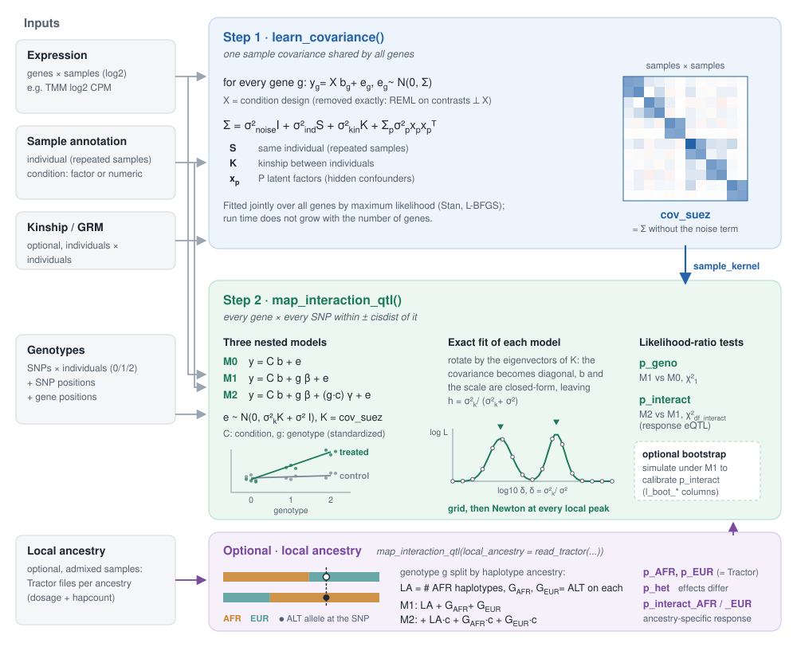

# suez: response-eQTL mapping in R

This is a fork of [davidaknowles/suez](https://github.com/davidaknowles/suez) with bug fixes, faster model
fits, parallel processing, local-ancestry (Tractor-style) models for admixed samples and new documentation. All modifications are listed in [CHANGELOG.md](CHANGELOG.md).

`suez` maps expression QTLs, and genotype x condition (response) eQTLs, in studies where individuals are
measured more than once, for example before and after a treatment. It extends the PANAMA approach
([Fusi et al. 2012](https://doi.org/10.1371/journal.pcbi.1002330)) to handle:

- several conditions per individual, categorical (control / treated) or continuous (dose, time, age)
- hidden confounders, learned as latent factors
- repeated samples of the same individual, and known relatedness (a kinship matrix or GRM)
- admixed individuals: ancestry-specific eQTL and response-eQTL effects from local ancestry, with the
  models of [Tractor](https://github.com/Atkinson-Lab/Tractor) inside the suez mixed model
  ([below](#local-ancestry-admixed-samples))

It works in two steps:

1. `learn_covariance()` learns a samples x samples covariance from all genes: latent factors, plus the
   same-individual and kinship components.
2. `map_interaction_qtl()` tests every cis-SNP of every gene with a linear mixed model that uses that
   covariance. Each SNP gets a test of the genotype effect and a test of the genotype x condition
   interaction.



A worked example from raw counts and a joint-called VCF to eQTL calls (filtering, TMM normalization,
genotype QC, both suez steps, multiple testing) is in the
[vignette](https://ricardovialle.github.io/suez/doc/suez.html) (source:
[vignettes/suez.Rmd](vignettes/suez.Rmd)).

## Installation

```r
install.packages("pak")
pak::pak("ricardovialle/suez")
```

You need a C++17 compiler (Xcode command line tools on macOS, Rtools on Windows, g++ or clang on Linux).
The Stan model compiles during installation, which takes about a minute. Dependencies, including
rstan / StanHeaders >= 2.26, are installed automatically.

To read genotypes straight from a VCF, also install the Bioconductor packages:

```r
pak::pak(c("VariantAnnotation", "GenomicRanges", "IRanges"))
```

## Quick start

This example simulates a small study (50 individuals x 2 conditions, 20 genes) with one planted
response eQTL, then runs both steps. It runs in a few seconds.

```r
library(suez)
library(doMC)
registerDoMC(4)                    # genes are processed in parallel
set.seed(1)

## Toy data: 50 individuals, each measured in two conditions (100 samples)
n_ind = 50
individuals = sprintf("ind%02d", 1:n_ind)
anno = data.frame(individual = rep(individuals, each = 2),          # one row per sample,
                  condition  = rep(c("control", "treated"), n_ind)) # same order as expression columns

n_genes = 20; snps_per_gene = 10
genotype = matrix(rbinom(n_genes * snps_per_gene * n_ind, 2, 0.3),  # ALT allele counts 0/1/2
                  ncol = n_ind, dimnames = list(paste0("snp", 1:(n_genes * snps_per_gene)), individuals))
snploc  = data.frame(snpid = rownames(genotype), chr = "chr1",
                     pos = rep(1:n_genes * 1e6, each = snps_per_gene) + 1:snps_per_gene * 1000)
geneloc = data.frame(geneid = paste0("gene", 1:n_genes), chr = "chr1",
                     left = 1:n_genes * 1e6, right = 1:n_genes * 1e6 + 5000)

expression = matrix(rnorm(n_genes * 2 * n_ind), n_genes,
                    dimnames = list(geneloc$geneid, paste0(anno$individual, "_", anno$condition)))
# gene1: snp1 effect only in treated samples (a response eQTL)
g = genotype["snp1", anno$individual]
expression["gene1", ] = expression["gene1", ] + 1.5 * g * (anno$condition == "treated")

## Step 1: learn the sample covariance (latent factors + repeated individuals)
qq = t(apply(expression, 1, function(x) qnorm((rank(x) - 0.5) / length(x))))
step1 = learn_covariance(qq, anno, P = 5)

## Step 2: test every cis-SNP for a genotype effect and a genotype x condition effect
res = map_interaction_qtl(expression, genotype, geneloc, snploc, anno,
                          sample_kernel = step1$cov_suez, cisdist = 1e5,
                          checkpoint_dir = "suez_checkpoints")
head(res[order(res$p_interact), c("gene", "cis_snp", "p_geno", "p_interact", "beta_geno", "se_geno")], 3)
```

```
      gene cis_snp      p_geno   p_interact  beta_geno   se_geno
1    gene1    snp1 0.008205507 4.713019e-06 0.34367690 0.1265651
121 gene13  snp121 0.080817355 1.914605e-03 0.20458709 0.1162533
103 gene11  snp103 0.655268155 9.233996e-03 0.04833264 0.1081731
```

The planted response eQTL, `gene1` / `snp1`, has the smallest interaction p-value.

## Inputs

| Argument | Format |
|---|---|
| expression (`input`) | numeric matrix, genes x samples, log2 scale (e.g. log2 CPM). Row names are gene ids. Columns are samples, **in the same order as the rows of `anno`** (column names are not used for matching). |
| `anno` | data.frame, one row per sample, with columns `individual` (id matching the genotype column names) and `condition` (factor / character for categories, numeric for a continuous condition). |
| `genotype` | numeric matrix, SNPs x individuals, with ALT allele counts 0/1/2 (`NA` allowed: imputed per gene with an SVD of the cis genotypes). Row names are SNP ids, column names individual ids. It can also be a `Rsamtools::TabixFile` of a bgzipped, indexed VCF (GT field). |
| `snploc` | data.frame with columns `snpid`, `chr`, `pos`. |
| `geneloc` | data.frame with columns `geneid`, `chr`, `left`, `right` (gene start and end). Genes in both `geneloc` and `rownames(input)` are tested. |
| `kinship_matrix` (step 1, optional) | individuals x individuals relatedness matrix (e.g. a GRM from plink or GCTA), with row and column names that match `anno$individual`. |

`chr` must use the same naming in `snploc` and `geneloc` (`"chr1"` vs `"1"`).

## Step 1: `learn_covariance()`

```r
step1 = learn_covariance(qq, anno, kinship_matrix = NULL, P = 20)
```

- `qq`: a normalized expression matrix (genes x samples), for example quantile-normalized per gene as in
  the example above. Use all expressed genes, not only the ones you will test.
- `P`: the number of latent factors. Factors that are not needed can shrink towards zero variance, so
  choosing a generous `P` is usually safe.
- The run time depends on the number of samples, not the number of genes.

It returns a list:

- `cov_suez`: the samples x samples covariance (latent factors + same individual + kinship). Pass it to
  `map_interaction_qtl()` as `sample_kernel`.
- `optimized_fit`: the `rstan::optimizing` result. `optimized_fit$par$s` holds the fitted variances of
  the noise, same-individual and kinship components; `optimized_fit$par$s_adjustable` holds those of the
  latent factors. Check `optimized_fit$return_code == 0` (a warning is printed otherwise; pass a larger
  `iter =` to give the optimizer more iterations).

## Step 2: `map_interaction_qtl()`

```r
res = map_interaction_qtl(input, genotype, geneloc, snploc, anno,
                          sample_kernel = step1$cov_suez,
                          normalization_approach = "qq",    # per-gene quantile normalization (default)
                          permutation_approach = "boot",    # one parametric bootstrap draw per SNP
                          cisdist = 1e5,                    # cis window: gene +/- 100 kb
                          maf_threshold = 0.05,
                          checkpoint_dir = "suez_checkpoints")
```

- `input` is the log2 expression matrix. The default `normalization_approach = "qq"` quantile-normalizes
  each gene, so pass the log2 matrix, not `qq` from step 1. Other choices: `"log"` (centre and scale),
  `"linear"` (on 2^input) and `"none"`.
- Without a `sample_kernel`, the model only accounts for repeated samples of the same individual.
- For each gene, SNPs with `snploc$chr == chr` and `left - cisdist < pos < right + cisdist` are tested.
  SNPs with fewer than 5 ALT alleles in total, or no variation, are skipped. `maf_threshold` drops SNPs
  whose minor allele frequency is at or below the threshold.
- `permutation_approach = "permute"` shuffles the genotype labels per gene (a null run); `"none"` skips the
  bootstrap (about a third less time).
- With `debug = FALSE` (the default) all console output is suppressed during the run, and a gene that
  fails with an error is dropped from the results. Use `debug = TRUE` to see progress and stop at the
  first error.

### Results

A data.frame with one row per tested gene x SNP:

| Column | Meaning |
|---|---|
| `gene`, `cis_snp` | gene and SNP ids |
| `l0` | log-likelihood of the model without genotype (condition effects only) |
| `l_geno` | log-likelihood with the genotype added |
| `l_interact` | log-likelihood with the genotype and genotype x condition terms |
| `p_geno` | p-value of the genotype effect: likelihood-ratio test of `l_geno` vs `l0`, 1 df |
| `df_interact` | degrees of freedom of the interaction test: 1 for a numeric condition, (levels - 1) for a factor |
| `p_interact` | p-value of the genotype x condition (response eQTL) effect: LRT of `l_interact` vs `l_geno` |
| `beta_geno`, `se_geno` | genotype effect per ALT allele, averaged over conditions, and its standard error (GLS, in normalized expression units) |
| `l_boot_geno`, `l_boot_interact` | `permutation_approach = "boot"` only: log-likelihoods of the genotype and interaction models on one dataset simulated under the genotype-only model |

Log-likelihoods leave out constants; only their differences are meaningful. A fit that fails gives `NA`.

`suez` does not write the results to disk; save them yourself, for example:

```r
readr::write_tsv(res, "suez_results.tsv.gz")
```

### Calibrating interaction p-values with the bootstrap

`2 * (l_boot_interact - l_boot_geno)` is one draw of the interaction likelihood ratio under the null of
no interaction, for each SNP. Pooled over all tests, these draws give a null distribution for the observed
ratios, which you can use to check or replace the chi-square p-values:

```r
lr      = 2 * (res$l_interact - res$l_geno)
lr_null = 2 * (res$l_boot_interact - res$l_boot_geno)
res$p_interact_boot = sapply(lr, function(x) mean(c(lr_null, Inf) >= x, na.rm = TRUE))
```

The smallest possible empirical p-value is 1 / (number of tests + 1), so this works best on a full
genome-wide run.

### Checkpoint files

With `checkpoint_dir`, each gene's results are written as soon as that gene finishes:

```
suez_checkpoints/
  gene1.txt.gz
  gene10.txt.gz
  ...
```

Each file is a gzipped tab-separated table with the columns above, one row per SNP. If a run stops,
calling `map_interaction_qtl()` again with the same `checkpoint_dir` reads finished genes from these files
and only computes the rest. The files are reused as they are, so delete the directory (or use a new one)
after changing the data or the arguments. Genes with no testable SNP get no file.

## Local ancestry (admixed samples)

For admixed individuals, `map_interaction_qtl()` can estimate eQTL and response-eQTL effects separately for
each ancestry, using local ancestry as in [Tractor](https://github.com/Atkinson-Lab/Tractor) (Atkinson et
al. 2021). The input is Tractor's per-ancestry files: phase the genotypes, infer local ancestry (RFMix2 or
FLARE), and run Tractor's `extract_tracts.py` (or `extract_tracts_flare.py`). This writes, for each ancestry
`k`, `<prefix>.anck.dosage.txt` (ALT alleles carried on ancestry-`k` haplotypes) and `<prefix>.anck.hapcount.txt`
(number of ancestry-`k` haplotypes, 0/1/2).

```r
la = read_tractor("cohort/chr22.phased", ancestry_names = c("AFR", "EUR"))  # dosage, hapcount, snploc
global = sapply(la$hapcount, colMeans) / 2        # global ancestry per individual (or use RFMix .Q / PCs)

step1 = learn_covariance(qq, anno, kinship_matrix = grm, P = 10)   # keep the GRM: see below
res = map_interaction_qtl(input, NULL, geneloc, la$snploc, anno,
                          sample_kernel = step1$cov_suez,
                          local_ancestry = la,
                          covariates = cbind(AFR = global[anno$individual, "AFR"]),
                          cisdist = 1e5)
```

For each SNP, with LA the haplotype counts of the first k - 1 ancestries and G_a the ALT dosage on
ancestry-a haplotypes, six nested models are fitted (each also includes the condition and `covariates`):

| Model | Terms | Used for |
|---|---|---|
| M0 | LA | null of the eQTL test |
| M1 | LA + G_1 ... G_k | ancestry-specific eQTL effects (Tractor's model) |
| M1s | LA + (G_1 + ... + G_k) | one effect shared by all ancestries |
| M1c | M1 + LA x condition | null of the response test |
| M2 | M1c + G_1 ... G_k x condition | ancestry-specific response eQTL |
| M2s | M1c + (G_1 + ... + G_k) x condition | one response shared by all ancestries |

| Column | Meaning |
|---|---|
| `p_geno`, `df_geno` | any eQTL effect: M1 vs M0 (df = number of ancestries tested) |
| `p_het`, `df_het` | eQTL effects differ between ancestries: M1 vs M1s |
| `p_interact`, `df_interact` | any response eQTL: M2 vs M1c |
| `p_interact_het` | responses differ between ancestries: M2 vs M2s |
| `beta_<anc>`, `se_<anc>`, `p_<anc>` | eQTL effect per ALT allele on that ancestry's haplotypes (Wald, M1) |
| `beta_interact_<anc>`, `se_interact_<anc>`, `p_interact_<anc>` | response effect on that ancestry (Wald, M2; numeric or 2-level condition) |
| `af_<anc>`, `laprop_<anc>` | ALT frequency on that ancestry's haplotypes, and its share of haplotypes at the SNP |
| `l0`, `l_geno`, `l_geno_shared`, `l_interact_null`, `l_interact`, `l_interact_shared` | log-likelihoods of M0 ... M2s |
| `l_boot_interact_null`, `l_boot_interact` | bootstrap under M1c (`permutation_approach = "boot"`): `2 * (l_boot_interact - l_boot_interact_null)` is a null draw of the response LR |

- **Same answers as Tractor**: with one sample per individual, no relatedness and the default kernel, the
  ancestry-specific betas, SEs and p-values equal Tractor's `run_tractor.R` linear model (tested to 1e-13).
  suez adds the random effect (repeated samples, kinship, hidden confounders), the response tests, the
  joint and heterogeneity tests, and more than one condition.
- **Use a GRM.** A GRM in step 1 (preferably leaving out the tested chromosome) does not absorb the
  ancestry-specific effects: in simulations the per-ancestry betas and power were the same with and without
  it. Without it, related individuals inflate the tests (λ 1.18 vs 1.04 for the eQTL test with sibling
  pairs). Add global ancestry as a fixed covariate as well.
- **One condition**: with a single value of `anno$condition` (e.g. `condition = 1`), suez maps eQTLs
  only (no interaction terms), as a Tractor GWAS with a random effect.
- **Rare ancestries**: an ancestry's terms are dropped for a SNP with fewer than 5 ALT alleles on that
  ancestry (its columns are `NA` and the degrees of freedom shrink). Ancestry-specific tests need many
  haplotypes of that ancestry: in simulations with 300 individuals (33% of haplotypes from the minor
  ancestry), a response effect of 0.6 SD per allele present only in the minor ancestry was found 45% of
  the time at p < 1e-4, against 6% by the standard (pooled genotype) suez test.
- **LD caveat**: at a SNP that only tags the causal variant, LD that differs between ancestries makes the
  effects look different (`p_het` < 0.05 in 28% of simulated tag SNPs whose causal effect was shared).
  Treat ancestry differences at non-lead SNPs with care, and fine-map before interpreting them.
- Both pooled and local-ancestry analyses are worth running: when the response is the same in all
  ancestries, the standard test (1 df) has slightly more power than the k-df local-ancestry test.
- Local-ancestry matrices must be complete (no `NA`), and a `TabixFile` genotype is not supported in this
  mode. Each matrix is dense in memory: read one chromosome at a time.

## Parallel processing and reproducibility

Genes run in parallel on the registered `foreach` backend; register one before calling
`map_interaction_qtl()`:

```r
library(doMC); registerDoMC(8)                      # macOS / Linux (forked processes)
# or: library(doParallel); registerDoParallel(8)    # any platform, including Windows
```

Without a registered backend, genes run one at a time (with a `foreach` warning). Each gene draws its own
random seed from your R session, so after `set.seed()` the results are the same for any number of cores
and either backend. For genome-wide runs on a cluster, you can also split genes across jobs (e.g. by
chromosome) by subsetting `geneloc`.

Rough timings on an Apple M5: step 1 takes a few seconds for 200 samples, whatever the number of genes;
step 2 with the bootstrap processes about 4,500 tests per second per core with 200 samples (measured
with 1 million SNPs in `snploc`; about 1,400 with 500 samples). A genome-wide run of 10^8 gene x SNP tests
is then roughly 6 core-hours.

## Tests

`tests/` run with `R CMD check` (about 15 s). They compare every likelihood-ratio test with an exact
reference (including a likelihood with two peaks and every local-ancestry model), check recovery of known
variances in step 1, the local-ancestry estimates against Tractor's linear model, `read_tractor()`, results
on 1 vs 2 cores, checkpoint files and the error checks.

## Citation

Knowles DA\*, Burrows CK\*, Blischak JD, Patterson KM, Serie DJ, Norton N, Ober C, Pritchard JK, Gilad Y
(2018). Determining the genetic basis of anthracycline-cardiotoxicity by molecular response QTL mapping in
induced cardiomyocytes. *eLife* 7:e33480. https://doi.org/10.7554/eLife.33480

## License

GPL (>= 3). See [LICENSE](LICENSE).
